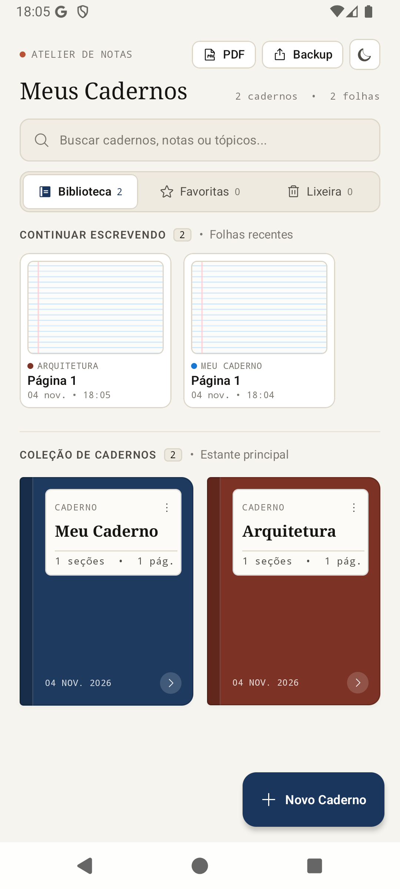
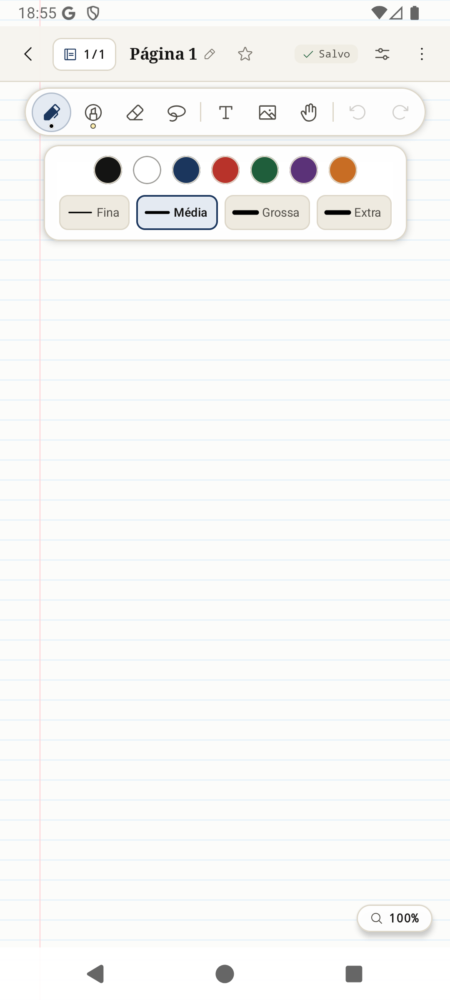
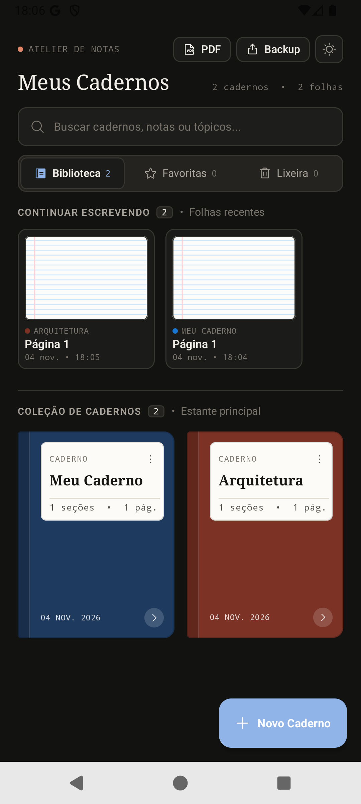
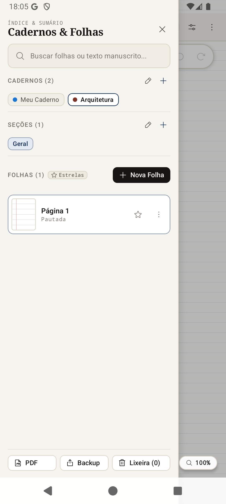
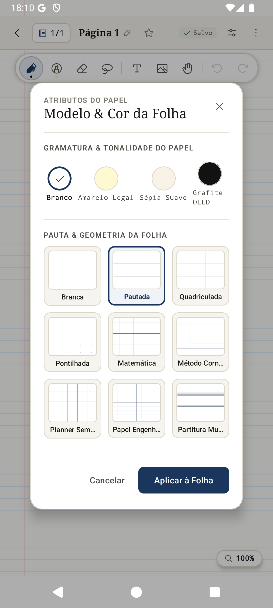
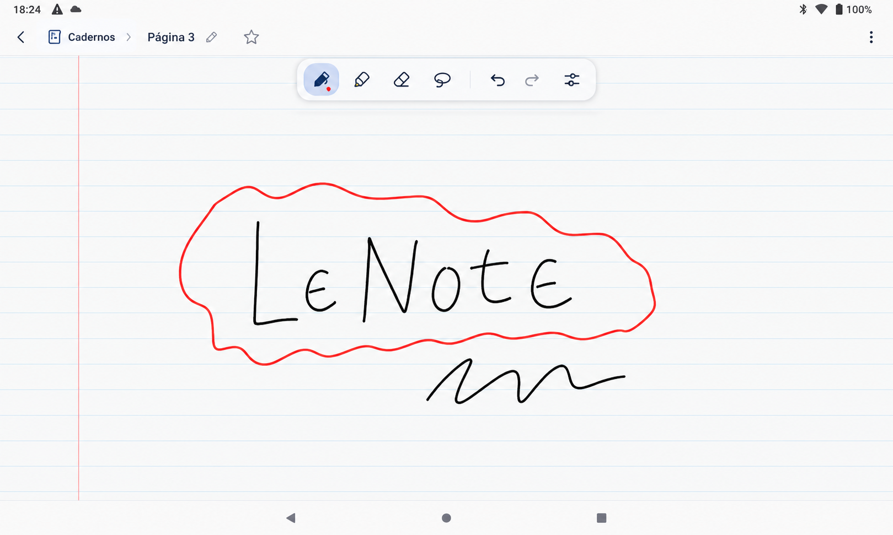
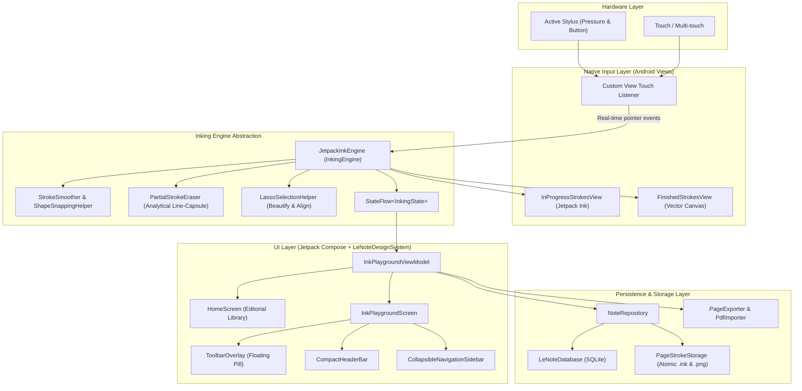

# LeNote

<p align="center">
  
  &nbsp;&nbsp;
  
  &nbsp;&nbsp;
  
</p>

<p align="center">
  <strong>A handwriting-first editorial notebook for Android tablets & phones.</strong><br/>
  <em>Crafted with a custom "Warm Paper & Editorial Ink" design system and powered by Google's Jetpack Ink engine.</em>
</p>

<p align="center">
  
  
  
  
  
  
  <a href="https://github.com/LirielC/LeNote/releases/latest"></a>
</p>

---

## Visual Overview

| Editorial Library (Warm Paper) | Writing Studio & Ink Palette | Index Sidebar & Search | Paper Templates & Stock |
| :---: | :---: | :---: | :---: |
|  |  |  |  |

<details>
<summary><strong>View Tablet Landscape Handwriting Preview</strong></summary>
<br/>
<p align="center">
  
</p>
</details>

---

## Why I Built LeNote

LeNote started because I lost the note-taking application I relied on every single day.

The handwriting application I used on my tablet was discontinued. After trying several alternative note-taking apps available for Android, I realized that very few provided the natural, low-latency handwriting experience I expected. Most apps either treated the stylus as a secondary mouse pointer, suffered from sluggish rendering pipelines, or cluttered the writing canvas with intrusive desktop-style toolbars.

I use a **Lenovo Xiaoxin Pad 2022 (TB128FU)** paired with the **Lenovo Precision Pen 2**. This hardware is responsive, portable, and capable, but finding software that unlocked its hardware digitizer in an honest, distraction-free way proved frustrating.

Instead of endlessly searching for another replacement that never quite felt right, I decided to build my own handwriting notebook.

That project became **LeNote**.

---

## The Problem

Writing by hand on digital paper is fundamentally different from typing or drawing vector art:

1. **Latency and Jitter**: Many Android note-taking apps wrap cross-platform web views or heavy UI frameworks over the touch canvas, creating perceptible input lag. Others apply aggressive smoothing filters that distort cursive handwriting and round off sharp corners.
2. **Accidental Palm and Finger Input**: When writing with a physical pen, resting your palm on the screen is inevitable. Without precise discrimination between stylus digitizer events and capacitive finger touches, unwanted ink splatters and accidental zoom jumps ruin the flow.
3. **Canvas Clutter**: Tablets and phones offer finite screen real estate. Traditional note apps crowd the screen with fixed sidebars, multi-tier toolbars, and generic UI cards, treating the actual writing page as an afterthought.
4. **Proprietary Lock-in**: Many solutions store user notes in proprietary binary formats or closed cloud services without straightforward options for clean vector export or offline backup.

---

## What LeNote Is

LeNote is a focused, local-first handwriting notebook designed with an **Editorial Minimalist ("Warm Paper & Editorial Ink")** aesthetic:

- **Paper-Centric & Editorial**: Inspired by cloth-bound atelier notebooks and printed monographs. Warm cotton-paper surfaces (`#F6F4EE`), crisp ivory plates (`#FCFBF8`), `1dp` hairline borders, and a strong typographic hierarchy (`Serif` headlines, `Sans-Serif` controls, and `Monospace` indices) keep the focus on your notes.
- **Engineered for Low Latency**: Powered directly by Google's **Jetpack Ink** (`androidx.ink`) library, separating in-progress hardware rendering from finalized vector strokes.
- **Precision Handwriting & Media Tools**: Includes pressure-sensitive ink pens (including Obsidian, White Chalk Ink for dark/OLED paper, Atelier Navy, Crimson, Botanical Green, Plum, and Ochre), highlighters, an analytical partial stroke eraser, polygon lasso with handwriting beautification & baseline alignment, shape snapping, text boxes, and image attachments.
- **Hierarchical Organization**: Organizes thoughts into **Notebooks → Sections → Pages**, with a "Continue Writing" recent pages carousel, a Favorites collection, and a Soft-Delete Trash bin, backed by a local SQLite database and atomic file storage.
- **Standalone and Portable**: Full vector PDF import & export, high-resolution PNG export, and complete `.lenote` workspace archive import/export.

---

## Built for My Hardware First

While LeNote runs on any compatible Android device running **Android 7.0 (API 24) or newer**, it is engineered and calibrated around:

- **Device**: Lenovo Xiaoxin Pad 2022 (`TB128FU`)
- **Stylus**: Lenovo Precision Pen 2 (Wacom AES protocol, active pressure sensing, primary barrel button)
- **Orientation**: Adaptive layout for both Tablet Landscape/Portrait and Phone screens

Every threshold—from palm rejection and single-finger scrolling to stylus barrel button toggling—was tuned against real-world handwriting sessions on this device.

---

## Features

### Inking, Calligraphy & Media
- **Pressure-Sensitive Pen**: Smooth, responsive ink with dynamic line variation powered by Jetpack Ink's stock pressure brush (`StockBrushes.pressurePen()`), featuring 7 curated inks (including **White Ink** with adaptive UI contrast for dark/OLED sheets) and 4 visual stroke thicknesses (`Fina`, `Média`, `Grossa`, `Extra`).
- **Highlighter**: Semi-transparent, layered highlighter that marks underneath handwritten text without obscuring strokes (`StockBrushes.highlighter()`).
- **Analytical Partial Stroke Eraser**: Slices and trims strokes at the exact intersection of the eraser capsule in real time. Does not convert vector strokes to pixelated bitmaps.
- **Stylus Button Eraser**: Pressing and holding the primary barrel button on the stylus instantly activates the eraser, returning to the previous tool upon release.
- **Geometric Shape Snapping**: Pause briefly at the end of drawing a line, rectangle, circle, or triangle to snap the freehand stroke into crisp geometry (`ShapeSnappingHelper`).
- **Lasso Selection & Handwriting Refinement**: Freeform polygon selection using ray-casting algorithms to move, recolor, duplicate, delete, **beautify handwriting**, or **align strokes to paper rulings**.
- **Rich Canvas Media**: Insert movable, resizable **Text Boxes** and **Images** directly onto the sheet alongside handwritten strokes (`CanvasMediaOverlay`).
- **Undo / Redo History**: Unlimited, operation-based history stack supporting stroke additions, partial erasure splits, deletions, and lasso transformations.
- **Configurable Handwriting Smoothing**: Conservative post-stroke geometric damping (`OFF`, `LOW`, `MEDIUM`) that reduces hardware digitizer micro-jitter without altering intentional letter corners or adding live input latency.

### Canvas, Paper Stock & Navigation
- **Intent-Based Touch Handling**:
  - **Stylus**: Handwriting, erasing, and selection.
  - **Single Finger**: Smooth document panning (or optional **Touch Inking** toggle right on the toolbar when writing without a stylus).
  - **Two Fingers**: Pinch-to-zoom and canvas panning.
  - **Palm Rejection**: Discards accidental palm contact during active writing.
- **9 Procedural Paper Templates & 4 Paper Stocks**:
  - **Paper Stocks**: Crisp White (`Branco`), Legal Pad Yellow (`Amarelo Legal`), Warm Sepia (`Sépia Suave`), and Dark OLED Graphite (`Grafite OLED`).
  - **Vector Rulings**: Blank (`Branca`), Ruled (`Pautada`), Grid (`Quadriculada`), Dotted (`Pontilhada`), Mathematics (`Matemática`), Cornell Notes (`Método Cornell`), Weekly Planner (`Planner Semanal`), Isometric / Engineering (`Papel Engenharia`), and Music Staff (`Partitura Musical`).
- **Nocturnal Dark Mode**: Full theme adaptation across the library, dialogs, and canvas (`LeNoteTheme`).
- **Canvas Zoom Control**: `0.25x` to `5.0x` zoom range with quick reset (`100%`) and fit-to-page actions.

### Organization, PDF Annotation & Backup
- **Editorial Hardcover Library**: Browse cloth-bound notebook folios in an adaptive multi-column grid, jump back into recent sheets via *"Continuar Escrevendo"*, or filter by **Biblioteca**, **Favoritas**, and **Lixeira** (Trash).
- **Collapsible Index Sidebar**: Quickly search pages and handwritten content, switch notebooks/sections, browse visual page thumbnails, reorder, duplicate, and favorite sheets.
- **PDF Import & Annotation**: Import any external `.pdf` document directly into a new notebook with each PDF page rendered as an annotatable sheet.
- **Clean Document Export**:
  - **Vector PDF**: Crisp, multi-resolution PDF generation using Android's native `PdfDocument` engine.
  - **High-Resolution PNG**: Exports the complete canvas independent of current viewport zoom or pan.
  - **Direct Intent Sharing**: Immediate banner action to open or share exported documents via secure `FileProvider` (`content://`).
- **Full Workspace Backup**: Export or restore complete notebook archives as structured `.lenote` packages (ZIP archive with binary metadata manifest and `.ink` stroke blobs).

---

## Technology Stack

| Component | Technology | Version | Purpose |
|---|---|---|---|
| **Language** | Kotlin | `2.1.20` | Core application and engine programming |
| **Platform** | Android | `minSdk 24`, `targetSdk 36`, `compileSdk 36.1` | Target OS environment |
| **Inking Engine** | Jetpack Ink (`androidx.ink`) | `1.0.0` | Low-latency inking, stroke geometry, brushes, and stroke serialization |
| **Handwriting OCR** | Google ML Kit Digital Ink | `19.0.0` | On-device handwriting recognition for search indexing and font beautification |
| **Input Capture** | Android Native Views | N/A | Low-latency dual-view architecture (`InProgressStrokesView` + `FinishedStrokesView`) |
| **Design System & UI** | Jetpack Compose + `LeNoteTheme` | BOM `2026.03.01` | Custom "Warm Paper & Editorial Ink" design system, adaptive grid, floating toolbar |
| **Database** | SQLite (`SQLiteOpenHelper` + FTS5) | Schema `v7` | Fast, local-first metadata storage and full-text handwriting search |
| **Async & State** | Kotlin Coroutines & Flow | N/A | Background file I/O, debounce auto-save, and reactive UI state |
| **Icons** | Phosphor Icons | Custom Compose | Consistent, lightweight vector icon system |
| **Build System** | Gradle / AGP | Gradle `9.4.1` / AGP `9.2.1` | Automated build system with version catalog (`libs.versions.toml`) |

---

## Architecture

LeNote uses a clean, decoupled architecture separating UI presentation, high-performance inking, and atomic local storage:



---

## Project Structure

```
LeNote/
├── app/
│   ├── src/
│   │   ├── main/
│   │   │   ├── java/com/example/lenote/
│   │   │   │   ├── data/             # SQLite database, entities, preferences, atomic stroke storage
│   │   │   │   │   ├── AppPreferences.kt
│   │   │   │   │   ├── Entities.kt
│   │   │   │   │   ├── LeNoteDatabase.kt
│   │   │   │   │   ├── NoteRepository.kt
│   │   │   │   │   └── PageStrokeStorage.kt
│   │   │   │   ├── export/           # Vector PDF/PNG exporters and PDF importer
│   │   │   │   │   ├── PageExporter.kt
│   │   │   │   │   └── PdfImporter.kt
│   │   │   │   ├── ink/              # Inking engine, Jetpack Ink views, smoother, eraser, lasso, snapping
│   │   │   │   │   ├── FinishedStrokesView.kt
│   │   │   │   │   ├── InkingEngine.kt
│   │   │   │   │   ├── JetpackInkEngine.kt
│   │   │   │   │   ├── LassoSelectionHelper.kt
│   │   │   │   │   ├── PageBackground.kt
│   │   │   │   │   ├── PartialStrokeEraser.kt
│   │   │   │   │   ├── ShapeSnappingHelper.kt
│   │   │   │   │   └── StrokeSmoother.kt
│   │   │   │   ├── ui/               # Compose UI, Custom Design System, screens, dialogs, ViewModel
│   │   │   │   │   ├── theme/
│   │   │   │   │   │   └── LeNoteDesignSystem.kt
│   │   │   │   │   ├── CanvasMediaOverlay.kt
│   │   │   │   │   ├── CollapsibleNavigationSidebar.kt
│   │   │   │   │   ├── HomeScreen.kt
│   │   │   │   │   ├── InkPlaygroundScreen.kt
│   │   │   │   │   ├── InkPlaygroundViewModel.kt
│   │   │   │   │   ├── PageTemplatePickerDialog.kt
│   │   │   │   │   └── PhosphorIcons.kt
│   │   │   │   └── MainActivity.kt   # Activity entry point and navigation transitions
│   │   │   ├── res/                  # App themes, launcher mipmaps, XML rules
│   │   │   └── AndroidManifest.xml   # Manifest declaration, FileProvider authorities
│   │   └── test/                     # Unit test suites (storage, smoothing, lasso, refinement, erasing)
│   └── build.gradle.kts              # App module dependencies and SDK configuration
├── docs/
│   └── images/                       # Application screenshots & previews
├── gradle/
│   └── libs.versions.toml
├── build.gradle.kts
└── settings.gradle.kts
```

---

## Documentation

Detailed technical and user documentation is available in the repository:

- **[User Guide (`docs/USER_GUIDE.md`)](docs/USER_GUIDE.md)**: Complete manual covering notebooks, sections, templates, stylus tools, partial eraser, lasso & handwriting recognition, PDF annotation, exports, and `.lenote` backups.
- **[Storage & Persistence Architecture (`docs/STORAGE.md`)](docs/STORAGE.md)**: Deep dive into the hybrid SQLite + atomic `.ink` file storage engine, `.ink` binary layout, thumbnail generation, `400ms` debounce auto-save, `fsync` crash safety, and `.lenote` ZIP archive structure.
- **[Dependencies & Licenses (`docs/DEPENDENCIES.md`)](docs/DEPENDENCIES.md)**: Full inventory of direct and transitive dependencies, exact versions, and licensing analysis (Apache-2.0 vs. proprietary Google ML Kit components).
- **[Privacy Policy & Technical Verification (`PRIVACY.md`)](PRIVACY.md)**: Verifiable breakdown of on-device data storage, ML Kit language model downloads, backup behavior, and compiled `AndroidManifest.xml` permissions.

---

## Building from Source & Verification

### Tested Build Environment
The project is verified against the following exact toolchain configuration:
- **JDK**: Java 17 (Temurin 17 recommended) or Java 21 *(Kotlin bytecode target: JVM 11)*
- **Gradle Wrapper**: `9.4.1` (configured in [`gradle/wrapper/gradle-wrapper.properties`](gradle/wrapper/gradle-wrapper.properties))
- **Android Gradle Plugin (AGP)**: `9.2.1` (configured in [`gradle/libs.versions.toml`](gradle/libs.versions.toml))
- **Kotlin**: `2.1.20`
- **Android SDK**: `compileSdk 36` (`minorApiLevel = 1`), `targetSdk 36`, `minSdk 24`

### 1. Clone the Repository
```bash
git clone https://github.com/LirielC/LeNote.git
cd LeNote
```

### 2. Run Unit Tests
Executes the JVM unit test suite covering storage atomicity, stroke smoothing, partial eraser geometry, lasso selection, and handwriting refinement:
```bash
# Linux / macOS
./gradlew testDebugUnitTest

# Windows (PowerShell)
.\gradlew.bat testDebugUnitTest
```

### 3. Build Debug APK
Generates an installable debug APK signed with the local Android debug key at `app/build/outputs/apk/debug/app-debug.apk`:
```bash
# Linux / macOS
./gradlew assembleDebug

# Windows (PowerShell)
.\gradlew.bat assembleDebug
```
To install directly onto a connected Android device or emulator:
```bash
.\gradlew.bat installDebug
```

### 4. Configure Production Release Signing & Build Release APK
For security, **no keystore files or passwords are committed to this repository**, and the `release` build type never falls back to a debug key.

To generate a signed production APK (`app/build/outputs/apk/release/app-release.apk`), provide your own keystore via either a local `keystore.properties` file (ignored by Git) or environment variables:

#### Option A: Using `keystore.properties` (Local Machine)
Create a `keystore.properties` file in the root directory of the project:
```properties
storeFile=/absolute/path/to/your-release-key.jks
storePassword=YOUR_STORE_PASSWORD
keyAlias=YOUR_KEY_ALIAS
keyPassword=YOUR_KEY_PASSWORD
```

#### Option B: Using Environment Variables (CI / Shell)
```bash
export LENOTE_KEYSTORE_PATH="/absolute/path/to/your-release-key.jks"
export LENOTE_KEYSTORE_PASSWORD="YOUR_STORE_PASSWORD"
export LENOTE_KEY_ALIAS="YOUR_KEY_ALIAS"
export LENOTE_KEY_PASSWORD="YOUR_KEY_PASSWORD"
```

Then run the release build:
```bash
# Linux / macOS
./gradlew assembleRelease

# Windows (PowerShell)
.\gradlew.bat assembleRelease
```
*(Note: If neither `keystore.properties` nor the `LENOTE_KEYSTORE_*` environment variables are provided, `assembleRelease` produces an unsigned APK at `app/build/outputs/apk/release/app-release-unsigned.apk` that you can sign manually using `apksigner`.)*

---

## License

This project's source code is licensed under the **MIT License** — see the [LICENSE](LICENSE) file for details. For third-party library licenses (including Google ML Kit terms), see [docs/DEPENDENCIES.md](docs/DEPENDENCIES.md).

## Author

Developed by **LirielC** ([lirielcastroreis@gmail.com](mailto:lirielcastroreis@gmail.com)) — [github.com/LirielC/LeNote](https://github.com/LirielC/LeNote)
