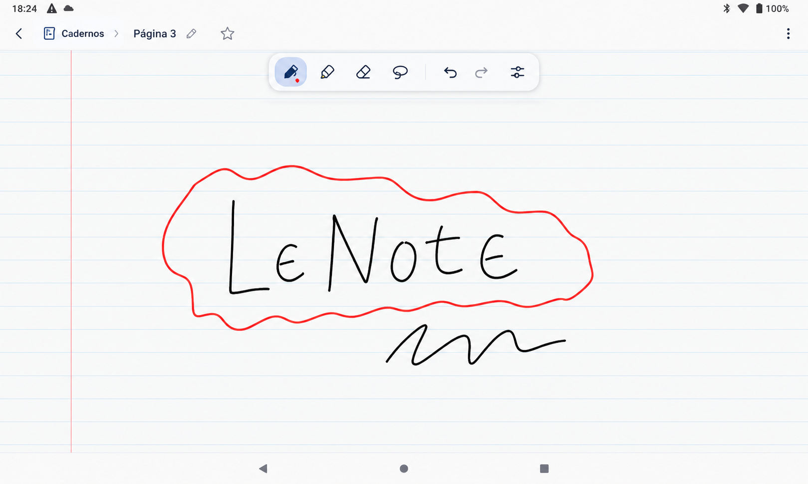
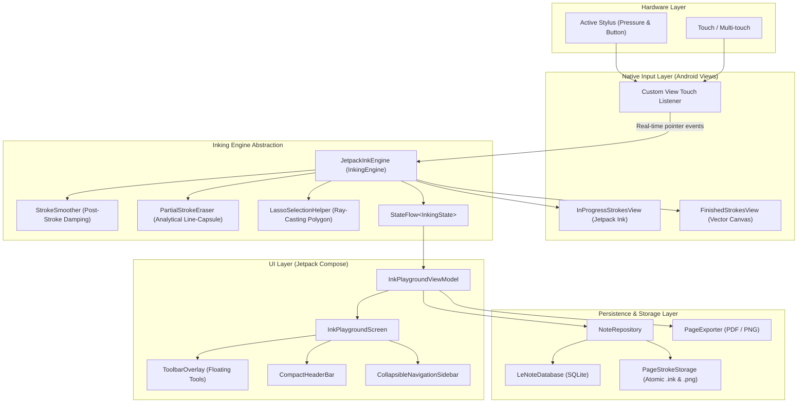

# LeNote

<p align="center">
  
</p>

<p align="center">
  <strong>A handwriting-first notebook for Android tablets.</strong>
</p>

<p align="center">
  
  
  
  
  
</p>

---

## Why I Built LeNote

LeNote started because I lost the note-taking application I relied on every single day.

The handwriting application I used on my tablet was discontinued. After trying several alternative note-taking apps available for Android, I realized that very few provided the natural, low-latency handwriting experience I expected. Most apps either treated the stylus as a secondary mouse pointer, suffered from sluggish rendering pipelines, or cluttered the writing canvas with intrusive desktop-style toolbars.

I use a **Lenovo Xiaoxin Pad 2022 (TB128FU)** paired with the **Lenovo Precision Pen 2**. This hardware is responsive, portable, and capable, but finding software that unlocked its hardware digitizer in an honest, distraction-free way proved frustrating.

Instead of endlessly searching for another replacement that never quite felt right, I decided to build my own handwriting notebook.

That project became **LeNote**.

---

## The Problem

Writing by hand on digital paper is fundamentally different from typing or drawing vector art:

1. **Latency and Jitter**: Many Android note-taking apps wrap cross-platform web views or heavy UI frameworks over the touch canvas, creating perceptible input lag. Others apply aggressive smoothing filters that distort cursive handwriting and round off sharp corners.
2. **Accidental Palm and Finger Input**: When writing with a physical pen, resting your palm on the screen is inevitable. Without precise discrimination between stylus digitizer events and capacitive finger touches, unwanted ink splatters and accidental zoom jumps ruin the flow.
3. **Canvas Clutter**: Tablets offer limited screen real estate. Traditional note apps crowd the screen with fixed sidebars, multi-tier toolbars, and complex formatting dialogs, treating the actual writing page as an afterthought.
4. **Proprietary Lock-in**: Many solutions store user notes in proprietary binary formats or closed cloud services without straightforward options for clean vector export or offline backup.

---

## What LeNote Is

LeNote is a focused, local-first handwriting notebook designed specifically for Android tablets:

- **Paper-Centric**: The sheet of paper is the dominant visual element. Controls stay out of your way until you explicitly need them via progressive disclosure.
- **Engineered for Low Latency**: Powered directly by Google's **Jetpack Ink** (`androidx.ink`) library, separating in-progress hardware rendering from finalized vector strokes.
- **Real Handwriting Tools**: Includes pressure-sensitive ink pens, highlighters, an analytical partial stroke eraser, and a polygon lasso selection tool.
- **Hierarchical Organization**: Organizes thoughts into **Notebooks → Sections → Pages**, backed by a local SQLite database and atomic file storage.
- **Standalone and Portable**: Full vector PDF and high-resolution PNG export, plus complete `.lenote` workspace archive import/export.

---

## Built for My Hardware First

While LeNote runs on any compatible Android tablet running **Android 7.0 (API 24) or newer**, it is engineered and calibrated around:

- **Device**: Lenovo Xiaoxin Pad 2022 (`TB128FU`)
- **Stylus**: Lenovo Precision Pen 2 (Wacom AES protocol, active pressure sensing, primary barrel button)
- **Orientation**: Tablet landscape / portrait

Every threshold—from palm rejection and single-finger scrolling to stylus barrel button toggling—was tuned against real-world handwriting sessions on this device.

---

## Features

### Inking and Handwriting
- **Pressure-Sensitive Pen**: Smooth, responsive ink with dynamic line variation powered by Jetpack Ink's stock pressure brush (`StockBrushes.pressurePen()`).
- **Highlighter**: Semi-transparent, layered highlighter that marks underneath handwritten text without obscuring strokes (`StockBrushes.highlighter()`).
- **Analytical Partial Stroke Eraser**: Slices and trims strokes at the exact intersection of the eraser capsule in real time. Does not convert vector strokes to pixelated bitmaps.
- **Stylus Button Eraser**: Pressing and holding the primary barrel button on the stylus instantly activates the eraser, returning to the previous tool upon release.
- **Lasso Selection Tool**: Freeform polygon selection using ray-casting algorithms to move, recolor, duplicate, or delete groups of handwritten strokes.
- **Undo / Redo History**: Unlimited, operation-based history stack supporting stroke additions, partial erasure splits, deletions, and lasso transformations.
- **Configurable Handwriting Smoothing**: Conservative post-stroke geometric damping (`OFF`, `LOW`, `MEDIUM`) that reduces hardware digitizer micro-jitter without altering intentional letter corners or adding live input latency.

### Canvas and Navigation
- **Intent-Based Touch Handling**:
  - **Stylus**: Handwriting, erasing, and selection.
  - **Single Finger**: Smooth document panning (scrolling vertically and horizontally) without leaving stray marks.
  - **Two Fingers**: Pinch-to-zoom and canvas panning.
  - **Palm Rejection**: Discards accidental palm contact during active writing.
- **Procedural Paper Backgrounds**: Vector-rendered backgrounds that scale smoothly with zoom:
  - Blank
  - Ruled (lined notebook)
  - Grid (graph paper)
  - Dotted (bullet journal)
  - Mathematics (cartesian coordinate grid)
- **Canvas Zoom Control**: 0.25x to 5.0x zoom range with quick reset (1.0x) and fit-to-page actions.

### Organization and Export
- **OneNote-Style Hierarchy**: Organize notes across **Notebooks**, **Sections**, and **Pages**.
- **Collapsible Navigation Sidebar**: Quickly search pages, browse visual thumbnails, reorder, duplicate, and favorite pages.
- **Clean Document Export**:
  - **Vector PDF**: Crisp, multi-resolution PDF generation using Android's native `PdfDocument` engine.
  - **High-Resolution PNG**: Exports the complete canvas independent of current viewport zoom or pan.
  - **Direct Intent Sharing**: Immediate banner action to open exported documents with the system viewer via secure `FileProvider` (`content://`).
- **Full Workspace Backup**: Export or restore complete notebook archives as structured `.lenote` packages (ZIP archive with binary metadata manifest and `.ink` stroke blobs).

---

## Technology Stack

| Component | Technology | Version | Purpose |
|---|---|---|---|
| **Language** | Kotlin | `2.1.20` | Core application and engine programming |
| **Platform** | Android | `minSdk 24`, `targetSdk 36` | Target OS environment |
| **Inking Engine** | Jetpack Ink (`androidx.ink`) | `1.0.0` | Low-latency inking, stroke geometry, brushes, and stroke serialization |
| **Input Capture** | Android Native Views | N/A | Low-latency dual-view architecture (`InProgressStrokesView` + `FinishedStrokesView`) |
| **User Interface** | Jetpack Compose / Material 3 | BOM `2026.03.01` | Declarative UI, floating toolbar, collapsible sidebar, and responsive modals |
| **Database** | SQLite (`SQLiteOpenHelper`) | N/A | Fast, local-first metadata storage (Notebooks, Sections, Pages) with `Flow` reactivity |
| **Async & State** | Kotlin Coroutines & Flow | N/A | Background file I/O, debounce auto-save, and reactive UI state |
| **Icons** | Phosphor Icons | Custom Compose | Consistent, lightweight vector icon system |
| **Build System** | Gradle / AGP | `9.2.1` | Automated build system with version catalog (`libs.versions.toml`) |

---

## Architecture

LeNote uses a clean, decoupled architecture separating UI presentation, high-performance inking, and atomic local storage:



### Why This Architecture?

1. **Compose + Android Views Hybrid**:
   Jetpack Compose provides modern state management, smooth animations, and clean modular UI components. However, active stylus handwriting requires immediate access to native `MotionEvent` batches (`getHistoricalX()`, `getHistoricalY()`, pressure, and tool types) with microsecond response times. LeNote hosts Jetpack Ink's native views inside Compose using `AndroidView`, giving zero-latency inking while keeping the rest of the application declarative.
2. **Decoupled Inking Engine**:
   The inking logic is encapsulated in `JetpackInkEngine`, which implements the clean `InkingEngine` interface. The UI interacts with the engine exclusively through high-level commands (`setTool`, `undo`, `redo`, `setCameraTransform`) and observes state through a single `StateFlow<InkingState>`.
3. **Separation of Metadata and Raw Strokes**:
   Vector strokes can grow significantly in size on detailed handwritten notes. Storing heavy binary blobs directly inside SQLite would degrade query performance and inflate the database. LeNote keeps the SQLite database lightweight and metadata-focused (titles, hierarchy, page settings, timestamps) and persists serialized strokes as individual atomic `.ink` files on disk.

---

## Handwriting Engine

The handwriting pipeline operates across two coordinated layers:

1. **In-Progress Layer (`InProgressStrokesView`)**:
   When the stylus touches the screen, pointer packets are passed directly to `InProgressStrokesView`. Jetpack Ink calculates the stroke mesh and renders the live line using low-latency front-buffer hardware pipelines.
2. **Finished Layer (`FinishedStrokesView`)**:
   Upon `ACTION_UP`, the raw stroke is delivered to `onStrokesFinished()`. Here, conservative post-stroke smoothing is applied, bounding boxes are pre-calculated for the eraser, and the finalized `Stroke` is placed into the canonical `finishedStrokes` list. The in-progress view cache is cleared immediately to prevent duplicated visuals.
3. **Analytical Partial Stroke Erasing**:
   Instead of deleting the entire stroke or treating the stroke as a raster image, `PartialStrokeEraser` performs analytical line-capsule intersection against the stroke's sample points. During `ACTION_MOVE`, it calculates lightweight preview chains without constructing expensive mesh objects on the hot path. The resulting sub-strokes are finalized only when the eraser lifts.

---

## Stylus and Palm Rejection

LeNote determines input intent by checking `MotionEvent.getToolType()` on every incoming pointer:

- **Stylus (`TOOL_TYPE_STYLUS` / `TOOL_TYPE_ERASER`)**:
  Classified as intentional handwriting or erasing. Live drawing begins immediately without waiting for gesture recognizers.
- **Single Finger (`TOOL_TYPE_FINGER`)**:
  Treated as a document navigation gesture. Panning triggers smoothly when the finger moves past a small slop threshold, allowing the user to reposition the page without leaving stray marks.
- **Two Fingers (`TOOL_TYPE_FINGER`)**:
  Treated as multi-touch pinch-to-zoom and pan.
- **Palm Contact**:
  Large capacitive contact patches, non-stylus inputs during active writing, or pointers marked with `FLAG_CANCELED` are dropped silently.

> **Honest Note**: Software-level palm rejection relies on the tablet's hardware digitizer reporting accurate touch boundaries and tool types. While tuned for the Lenovo Xiaoxin Pad 2022, occasional edge-case touches can still occur if a palm touches the screen prior to the stylus hovering in range.

---

## Handwriting Smoothing

Handwriting smoothing in LeNote is designed to correct hardware digitizer micro-jitter without turning handwriting into synthetic vector curves:

- **Post-Stroke Execution**: Smoothing runs only after a stroke is finished (`onStrokesFinished`), guaranteeing zero processing latency while writing.
- **Endpoint Anchoring**: The first and last sampled points of every stroke remain anchored to their original coordinates.
- **Corner-Aware Damping**: The algorithm checks the cosine angle between consecutive segments. Intentional sharp turns (such as vertices in cursive letters or angles in math symbols) have filter weights dampened automatically to prevent corner rounding.
- **Bounded Displacement**: Point displacement is clamped by `maxDisplacementWorldUnits`, ensuring that letters never distort or drift.
- **Configurable**: Users can choose between `OFF`, `LOW` (1-pass subtle jitter correction), and `MEDIUM` (2-pass smoothing).

---

## Project Structure

```
LeNote/
├── app/
│   ├── src/
│   │   ├── main/
│   │   │   ├── java/com/example/lenote/
│   │   │   │   ├── data/             # SQLite database, DAOs, entities, atomic stroke storage, repository
│   │   │   │   │   ├── Entities.kt
│   │   │   │   │   ├── LeNoteDatabase.kt
│   │   │   │   │   ├── NoteRepository.kt
│   │   │   │   │   └── PageStrokeStorage.kt
│   │   │   │   ├── export/           # Vector PDF and PNG document exporters
│   │   │   │   │   └── PageExporter.kt
│   │   │   │   ├── ink/              # Inking engine, Jetpack Ink views, smoother, eraser, lasso
│   │   │   │   │   ├── FinishedStrokesView.kt
│   │   │   │   │   ├── InkingEngine.kt
│   │   │   │   │   ├── JetpackInkEngine.kt
│   │   │   │   │   ├── LassoSelectionHelper.kt
│   │   │   │   │   ├── PageBackground.kt
│   │   │   │   │   ├── PartialStrokeEraser.kt
│   │   │   │   │   └── StrokeSmoother.kt
│   │   │   │   ├── ui/               # Compose UI, toolbar, sidebar, dialogs, ViewModel, icons
│   │   │   │   │   ├── CollapsibleNavigationSidebar.kt
│   │   │   │   │   ├── InkPlaygroundScreen.kt
│   │   │   │   │   ├── InkPlaygroundViewModel.kt
│   │   │   │   │   └── PhosphorIcons.kt
│   │   │   │   └── MainActivity.kt   # Activity entry point and lifecycle coordination
│   │   │   ├── res/                  # App themes, launcher mipmaps, XML rules
│   │   │   └── AndroidManifest.xml   # Manifest declaration, FileProvider authorities
│   │   └── test/                     # Unit test suites (storage, smoothing, lasso, partial erasing)
│   │       ├── ExampleUnitTest.kt
│   │       ├── Phase2To5UnitTest.kt
│   │       └── SmoothingConfigurationUnitTest.kt
│   └── build.gradle.kts              # App module dependencies and SDK configuration
├── docs/                             # Documentation assets
│   └── images/                       # Application preview screenshots
├── gradle/                           # Gradle wrapper and version catalog
│   └── libs.versions.toml
├── build.gradle.kts                  # Root build configuration
└── settings.gradle.kts               # Gradle settings and module inclusion
```

---

## Design Decisions

### Handwriting as a First-Class Citizen
Strokes are not treated as static pixel overlays on an image. They are stored as structured vector geometry with pressure and tilt attributes, allowing lossless zooming, dynamic recoloring, analytical slicing, and export at any resolution.

### Compose for UI, Android Views for Ink
Jetpack Compose handles layout responsiveness, theme consistency, and dialog state cleanly. High-frequency pointer events (`MotionEvent`), however, are best processed by dedicated native Android views to avoid frame drops and latency.

### Jetpack Ink over Custom OpenGL/Vulkan Renderer
Instead of implementing and maintaining a custom low-level graphics engine using OpenGL ES or Vulkan, LeNote leverages Google's official **Jetpack Ink** library (`androidx.ink`). This ensures standard stroke representations, optimized brush pipelines, and forward compatibility with Android platform improvements.

### Atomic Local-First Storage
Notes should never be lost due to an unexpected power outage or app termination. LeNote writes strokes to a temporary file, flushes file descriptors with `fd.sync()`, and renames the file atomically. The entire data layer works completely offline without requiring accounts or network connectivity.

### Progressive Disclosure
Handwriting requires focus. The floating toolbar contains only essential writing tools (Pen, Highlighter, Eraser, Lasso, Undo, Redo). Secondary actions—such as renaming pages, reordering, sheet background selection, and export—are housed neatly in the header menu.

---

## Roadmap

### Completed
- [x] Jetpack Ink dual-view architecture (`InProgressStrokesView` + `FinishedStrokesView`)
- [x] Pressure-sensitive ink pen and semi-transparent highlighter
- [x] Analytical partial stroke eraser with live cut preview
- [x] Stylus barrel button integration for instant eraser toggling
- [x] Freeform Lasso selection tool with moving, recoloring, and deleting
- [x] Conservative post-stroke handwriting smoothing (`OFF`, `LOW`, `MEDIUM`)
- [x] Stylus vs. finger discrimination (handwrite with pen, scroll with finger)
- [x] Two-finger pinch-to-zoom and canvas panning (0.25x to 5.0x)
- [x] Procedural paper backgrounds (Blank, Ruled, Grid, Dotted, Mathematics)
- [x] Local-first SQLite database and atomic `.ink` stroke file persistence
- [x] Notebook, Section, and Page hierarchy with collapsible sidebar
- [x] Full vector PDF export via Android `PdfDocument`
- [x] Full-resolution PNG canvas export
- [x] Secure file sharing and viewing via Android `FileProvider`
- [x] Complete workspace archive backup/restore (`.lenote` ZIP packages)
- [x] Unit test suite covering storage, smoothing, lasso, and partial eraser

### In Progress
- [ ] Optimization of page thumbnail generation in background threads
- [ ] Additional paper ruling configurations (custom line heights and margin colors)
- [ ] Gesture threshold fine-tuning for diverse stylus digitizers

### Planned
- [ ] Typed text blocks with floating virtual keyboard support
- [ ] Code snippet blocks with syntax highlighting
- [ ] Mathematical formula blocks (LaTeX rendering)
- [ ] Markdown and Mermaid diagram cards
- [ ] Image attachment blocks with freeform handwriting annotation
- [ ] Multi-page PDF import for annotating slides and documents
- [ ] Optional end-to-end encrypted cloud sync (Google Drive / WebDAV) respecting local-first principles

---

## Current Status

LeNote is an **active personal development project**. It originated as a targeted solution to replace a discontinued tablet handwriting application and has grown into a structured, reliable handwriting notebook for Android tablets.

The core inking engine, stroke editing tools, document export, and hierarchical storage are fully implemented and functional. While it is stable for daily handwriting sessions on the target hardware, it remains under active evolution as new capabilities are added.

---

## Getting Started

### Prerequisites
- **Android Studio**: Ladybug (2024.2.1) or newer
- **JDK**: Java 17 or Java 21
- **Android SDK**: `compileSdk 36`, `minSdk 24`
- **Recommended Device**: Android tablet running Android 11+ with an active stylus (e.g., Lenovo Xiaoxin Pad 2022 with Precision Pen 2, Samsung Galaxy Tab with S-Pen, or similar)

### Clone and Build

1. Clone the repository:
   ```bash
   git clone https://github.com/yourusername/LeNote.git
   cd LeNote
   ```

2. Compile the application and run unit tests:
   ```bash
   # On Linux / macOS
   ./gradlew testDebugUnitTest assembleDebug

   # On Windows (PowerShell)
   .\gradlew.bat testDebugUnitTest assembleDebug
   ```

3. Install on a connected Android tablet:
   ```bash
   .\gradlew.bat installDebug
   ```

---

## Contributing

Contributions, bug reports, and technical discussions are welcome!

If you find a bug, have an optimization for stylus latency, or want to discuss handwriting algorithms on Android tablets:
- Open an issue detailing your device model, stylus type, and Android version.
- Submit pull requests with focused, well-tested changes.

---

## License

License information will be added.
