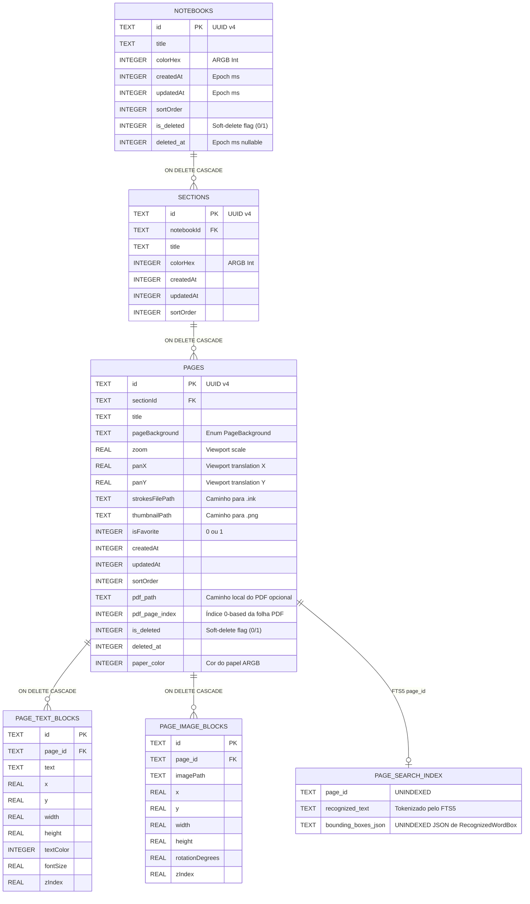
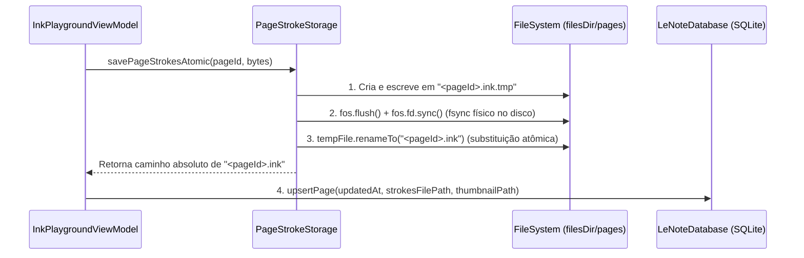

# Arquitetura de Armazenamento e Persistência — LeNote (`docs/STORAGE.md`)

O sistema de persistência do **LeNote** foi projetado como um motor híbrido **SQLite + Sistema de Arquivos Atômico**. Essa arquitetura separa metadados relacionais e índices de busca textual (armazenados no SQLite) dos payloads binários de geometria vetorial e mídia pesada (armazenados no diretório interno privado do aplicativo com escrita atômica).

---

## Sumário
1. [Visão Geral da Arquitetura Híbrida](#1-visão-geral-da-arquitetura-híbrida)
2. [Como os Cadernos, Seções e Páginas são Relacionados (SQLite)](#2-como-os-cadernos-seções-e-páginas-são-relacionados-sqlite)
3. [Como Funcionam os Arquivos Binários `.ink`](#3-como-funcionam-os-arquivos-binários-ink)
4. [Como os Thumbnails (Miniaturas) são Gerados e Armazenados](#4-como-os-thumbnails-miniaturas-são-gerados-e-armazenados)
5. [Como Funciona o Salvamento Automático (Auto-Save)](#5-como-funciona-o-salvamento-automático-auto-save)
6. [Como a Integridade dos Dados é Preservada](#6-como-a-integridade-dos-dados-é-preservada)
7. [Como Funciona a Importação e Exportação de Pacotes `.lenote`](#7-como-funciona-a-importação-e-exportação-de-pacotes-lenote)

---

## 1. Visão Geral da Arquitetura Híbrida

Armazenar dezenas de milhares de pontos de coordenadas de stylus diretamente em colunas `BLOB` do SQLite degrada a performance de leitura de listagens (`CursorWindow` de 2 MB no Android) e aumenta o risco de bloqueio de banco durante a escrita em tempo real.

Por isso, o LeNote divide a persistência em duas camadas coordenadas pelo [`NoteRepository`](../app/src/main/java/com/example/lenote/data/NoteRepository.kt):

1. **[`LeNoteDatabase`](../app/src/main/java/com/example/lenote/data/LeNoteDatabase.kt) (`databases/lenote.db` — Versão `7`)**:
   - Armazena a árvore hierárquica (`notebooks`, `sections`, `pages`), blocos de texto (`page_text_blocks`), referências de imagens (`page_image_blocks`) e o índice invertido de busca manuscrita (`page_search_index` via **SQLite FTS5**).
   - Mantém um espelho em memória (`LinkedHashMap`) sincronizado que alimenta `StateFlow`s reativos para a UI em Jetpack Compose e permite execução determinística em testes unitários JVM sem depender de `Context` Android.
2. **[`PageStrokeStorage`](../app/src/main/java/com/example/lenote/data/PageStrokeStorage.kt) (`filesDir/`)**:
   - `filesDir/pages/<pageId>.ink`: Arquivo binário compacto contendo os traços vetoriais serializados da página.
   - `filesDir/thumbs/<pageId>.png`: Miniatura pré-renderizada da página (`240 × 320 px`).
   - `filesDir/images/` e `filesDir/pdfs/`: Imagens e documentos PDF importados para uso local nas páginas.
   - `filesDir/exports/`: Cópia local dos documentos exportados em PDF e PNG.

---

## 2. Como os Cadernos, Seções e Páginas são Relacionados (SQLite)

O banco de dados `lenote.db` habilita explicitamente restrições de chave estrangeira na inicialização:

```kotlin
override fun onConfigure(db: SQLiteDatabase) {
    super.onConfigure(db)
    db.setForeignKeyConstraintsEnabled(true)
}
```

### Diagrama Entidade-Relacionamento (ERD)



### Lixeira (Soft Delete) vs. Exclusão Permanente
- **Soft Delete (`is_deleted = 1`)**: Quando o usuário move um caderno ou página para a lixeira (`moveToTrash` / `movePageToTrash`), o registro permanece no SQLite com `is_deleted = 1` e o timestamp `deleted_at`, e os arquivos `.ink` e `.png` são mantidos intactos para permitir restauração imediata (`restoreFromTrash`).
- **Hard Delete (`deleteNotebook` / `deletePage` / `emptyTrash`)**: Remove primeiro os arquivos físicos `.ink`, `.ink.tmp`, `.png` e `.png.tmp` do disco via `PageStrokeStorage.deletePageFiles(pageId)` e em seguida executa o `DELETE` no SQLite (que propaga `ON DELETE CASCADE` para seções, páginas e blocos de mídia).

---

## 3. Como Funcionam os Arquivos Binários `.ink`

Cada página armazena seus traços vetoriais em `filesDir/pages/<pageId>.ink`. A serialização e desserialização são implementadas em [`JetpackInkEngine.saveStrokes()`](../app/src/main/java/com/example/lenote/ink/JetpackInkEngine.kt#L3898-L3946) e [`JetpackInkEngine.loadStrokes()`](../app/src/main/java/com/example/lenote/ink/JetpackInkEngine.kt#L3950-L4056).

### Layout Binário do Arquivo `.ink` (`Big-Endian DataOutputStream`)

| Offset / Campo | Tipo | Tamanho | Descrição |
|---|---|---|---|
| `strokeCount` | `Int32` | 4 bytes | Quantidade total de traços (`finishedStrokes.size`) na página. |
| **Para cada Stroke (`0 .. strokeCount - 1`)**: | | | |
| ↳ `isHighlighter` | `Boolean` | 1 byte | `true` (`1`) se usa `StockBrushes.highlighter()`, `false` (`0`) se usa `StockBrushes.pressurePen()`. |
| ↳ `colorIntArgb` | `Int32` | 4 bytes | Cor ARGB de 32 bits do pincel (`brush.colorIntArgb`). |
| ↳ `brushSize` | `Float32` | 4 bytes | Espessura do traço no espaço de mundo (`brush.size`). |
| ↳ `batchLength` | `Int32` | 4 bytes | Tamanho em bytes do bloco de entradas codificado a seguir. |
| ↳ `batchBytes` | `ByteArray` | `batchLength` bytes | Lote comprimido de pontos (`x`, `y`, `elapsedTimeMillis`, `pressure`, `tilt`, `orientation`) gerado nativamente por `StrokeInputBatchSerialization.encode()`. |

Ao carregar um arquivo `.ink`:
1. O motor lê cada registro, decodifica o `ImmutableStrokeInputBatch` via `StrokeInputBatchSerialization.decode()`, reconstrói o `Brush` com `epsilon = 0.1f` e instancia o `Stroke(brush, inputBatch)`.
2. Cada `Stroke` carregado passa por `PartialStrokeEraser.prewarmStroke(stroke)`, pré-calculando seu bounding box em cache para que a borracha parcial e a seleção por laço funcionem instantaneamente no primeiro toque.

---

## 4. Como os Thumbnails (Miniaturas) são Gerados e Armazenados

As miniaturas exibidas na Barra Lateral e nos cartões da Biblioteca possuem resolução padrão de **`240 × 320 px`** (`Bitmap.Config.ARGB_8888`) e ficam salvas em `filesDir/thumbs/<pageId>.png`.

1. **Geração (`PageExporter.generateThumbnailBitmap`)**:
   - Calcula o viewport de mundo ocupado pelos traços da folha (`computePageWorldViewport`, mínimo `1200 × 1600` com padding de `64f`).
   - Aplica uma matriz de escala e centralização (`Matrix`) para enquadrar toda a área escrita dentro do bitmap `240 × 320`.
   - Renderiza na ordem: cor do papel → pauta vetorial (ou página do PDF de fundo) → blocos de imagem → caixas de texto → traços vetoriais via `CanvasStrokeRenderer`.
2. **Persistência Atômica (`PageStrokeStorage.savePageThumbnailAtomic`)**:
   - Comprime o bitmap em formato `PNG` (qualidade `90`) para um arquivo temporário `<pageId>.png.tmp`, faz `flush()` e substitui atomicamente `<pageId>.png`.
   - O contador reativo `thumbnailVersion` no `InkPlaygroundViewModel` é incrementado para notificar a UI Compose de que a miniatura no disco foi atualizada.

---

## 5. Como Funciona o Salvamento Automático (Auto-Save)

O LeNote nunca exige que o usuário toque em um botão "Salvar". O ciclo de salvamento automático em [`InkPlaygroundViewModel`](../app/src/main/java/com/example/lenote/ui/InkPlaygroundViewModel.kt) opera em três frentes complementares:

1. **Auto-Save Reativo com Debounce (`400 ms`)**:
   - Sempre que um traço é adicionado, apagado, movido pelo laço ou desfeito/refeito, o `JetpackInkEngine` incrementa seu contador monotônico `contentVersion`.
   - O `InkPlaygroundViewModel` observa `engine.state.map { it.contentVersion }.distinctUntilChanged()` e agenda uma corrotina com `delay(400L)` em `Dispatchers.IO`.
   - Se o usuário continuar escrevendo dentro da janela de `400 ms`, o timer é reiniciado para não competir por I/O durante uma palavra rápida; assim que a caneta pausa por `400 ms`, os bytes `.ink`, a miniatura `.png` e os metadados da página (`zoom`, `panX`, `panY`, `updatedAt`) são gravados em background e a indexação OCR/FTS5 é disparada.
2. **Flush Síncrono na Troca de Página / Caderno**:
   - Antes de alternar para outra página, seção ou caderno (`selectPage`, `selectSection`, `selectNotebook`), o ViewModel cancela qualquer debounce pendente e executa o salvamento imediato da página atual antes de carregar a próxima.
3. **Flush no Ciclo de Vida da Activity (`onStop` / `onPause`)**:
   - Quando o aplicativo vai para segundo plano ou a tela do tablet é desligada, `saveCurrentPageImmediate()` garante que nenhum traço recente fique apenas na memória RAM.

---

## 6. Como a Integridade dos Dados é Preservada

Para evitar páginas corrompidas ou truncadas (arquivos de `0 bytes`) em caso de queda abrupta de bateria, fechamento forçado pelo sistema operacional ou falha de I/O, [`PageStrokeStorage.savePageStrokesAtomic()`](../app/src/main/java/com/example/lenote/data/PageStrokeStorage.kt#L30-L60) implementa o padrão **Write-Replace Atômico com Sincronização de Descritor**:



1. **Arquivo Temporário Isolado (`.ink.tmp`)**: Os novos bytes nunca sobrescrevem diretamente o arquivo `<pageId>.ink` existente. Se o dispositivo desligar no meio da escrita, apenas o arquivo `.tmp` ficará incompleto, enquanto o `<pageId>.ink` anterior permanece 100% íntegro.
2. **`fos.fd.sync()` (`fsync`)**: Força o kernel Linux/Android a descarregar os buffers de cache de página para o armazenamento flash antes de prosseguir com a substituição do nome do arquivo.
3. **Renomeação com Fallback Seguro**: Tenta `tempFile.renameTo(targetFile)`; caso o sistema de arquivos subjacente exija remoção prévia ou cópia explícita, realiza `copyTo(..., overwrite = true)` seguido da limpeza do `.tmp`.
4. **Sincronização de Threads (`@Synchronized`)**: Todas as operações de leitura/escrita em `PageStrokeStorage`, `NoteRepository` e `LeNoteDatabase` são protegidas por monitores `@Synchronized`, impedindo condições de corrida (*race conditions*) entre o job de Auto-Save em background e ações síncronas da UI.

---

## 7. Como Funciona a Importação e Exportação de Pacotes `.lenote`

O LeNote suporta empacotamento completo de cadernos no formato portátil **`.lenote`** (um arquivo comprimido `ZIP` autossuficiente). Existem dois utilitários no código:

### 7.1. Formato Rico de Caderno (`NotebookPackageExporter` — Versão `2`)
Implementado em [`NotebookPackageExporter.kt`](../app/src/main/java/com/example/lenote/data/NotebookPackageExporter.kt), este é o formato utilizado pela interface do usuário ao exportar ou compartilhar um caderno completo.

#### Estrutura Interna do Arquivo `.lenote` (ZIP)
```text
Meu_Caderno.lenote (ZIP Archive)
├── metadata.json                  # Manifesto estruturado UTF-8 (versão 2)
├── strokes/
│   ├── <pageId_1>.ink             # Payload binário de strokes da página 1
│   └── <pageId_2>.ink             # Payload binário de strokes da página 2
└── media/
    ├── images/
    │   └── <imageFileName>.png    # Imagens incorporadas nas páginas
    └── pdfs/
        └── <pdfFileName>.pdf      # Documentos PDF de base anotados no caderno
```

#### O que o `metadata.json` contém:
- Metadados do arquivo (`version: 2`, `app: "LeNote"`, `timestamp`).
- Objeto `notebook` (`id`, `title`, `colorHex`, `createdAt`, `updatedAt`, `sortOrder`).
- Array `sections` com todas as seções do caderno.
- Array `pages` com todas as páginas, incluindo pauta (`pageBackground`), cor do papel (`paperColor`), estado da câmera (`zoom`, `panX`, `panY`), referência ao PDF (`pdfFileName`, `pdfPageIndex`), array `textBlocks` (caixas de texto com posição, fonte e cor) e array `imageBlocks` (imagens com posição, dimensão, rotação e `zIndex`).

#### Processo de Restauração (`importNotebookPackage`) e Prevenção de Colisão de IDs:
Ao importar um arquivo `.lenote`:
1. Os arquivos de `media/images/` e `media/pdfs/` são extraídos para `filesDir/images/` e `filesDir/pdfs/` com prefixo de timestamp (`imported_<timestamp>_<filename>`) para nunca sobrescrever mídias de outros cadernos.
2. **Remapeamento de UUIDs**: O importador gera **novos `UUID.randomUUID()`** para o caderno, para cada seção (`sectionIdMap[oldSecId] = newSecId`), para cada página (`newPageId`) e para cada bloco de texto/imagem.
3. Isso garante que você possa importar o mesmo arquivo `.lenote` múltiplas vezes (ou importar um backup no mesmo aparelho onde o caderno original ainda existe) sem causar colisão de chave primária (`PRIMARY KEY`) nem sobrescrever notas existentes.

### 7.2. Formato Binário Compacto de Workspace (`NoteRepository.exportBackupLenotePackage` — Versão `1`)
Implementado em [`NoteRepository.kt`](../app/src/main/java/com/example/lenote/data/NoteRepository.kt#L476-L642), grava um arquivo ZIP contendo `manifest.bin` (serializado via `DataOutputStream` binário) e `pages/<pageId>.ink` para backup rápido de todo o banco de dados de uma só vez.
