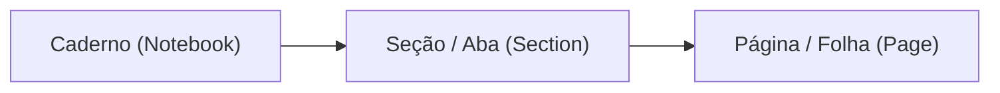

# Manual do Usuário — LeNote (`v1.0.2`)

Bem-vindo ao **LeNote**, um caderno digital editorial focado em escrita à mão de baixa latência para tablets e celulares Android. Este guia apresenta todas as ferramentas e recursos do aplicativo em detalhes.

---

## Sumário
1. [Primeiros Passos](#1-primeiros-passos)
2. [Como Criar Cadernos, Seções e Páginas](#2-como-criar-cadernos-seções-e-páginas)
3. [Como Utilizar a Caneta e as Ferramentas de Desenho](#3-como-utilizar-a-caneta-e-as-ferramentas-de-desenho)
4. [Como Funciona o Reconhecimento e Refinamento de Escrita](#4-como-funciona-o-reconhecimento-e-refinamento-de-escrita)
5. [Como Importar e Anotar PDFs](#5-como-importar-e-anotar-pdfs)
6. [Como Exportar Documentos (PDF e PNG)](#6-como-exportar-documentos-pdf-e-png)
7. [Como Fazer Backup e Restaurar Arquivos `.lenote`](#7-como-fazer-backup-e-restaurar-arquivos-lenote)

---

## 1. Primeiros Passos

Ao abrir o **LeNote** pela primeira vez, você verá a **Biblioteca Editorial** (Tela Inicial) e uma estrutura padrão já pronta para uso (`Meu Caderno` → `Notas Rápidas` → `Página 1`).

### Visão Geral da Biblioteca
- **Continuar Escrevendo**: Carrossel superior com acesso imediato às últimas folhas que você editou.
- **Abas de Filtragem**:
  - **Biblioteca**: Exibe todos os seus cadernos encadernados em grade adaptativa (1, 2 ou 3 colunas).
  - **Favoritas**: Reúne todas as páginas marcadas com estrela para consulta rápida.
  - **Lixeira**: Mantém cadernos e páginas excluídos temporariamente, permitindo restaurá-los ou esvaziar a lixeira permanentemente.
- **Cabeçalho de Configurações Rápidas**:
  - **Busca Global**: Pesquise títulos de páginas ou palavras escritas à mão dentro das notas.
  - **Idioma (`PT | EN | ES`)**: Alterna entre o idioma automático do Android, Português, Inglês ou Espanhol.
  - **Tema Visual**: Alterna entre Claro (*Warm Paper*), Escuro (*Nocturnal Slate*) ou Automático do Sistema.
  - **Densidade da Grade**: Alterna a visualização dos cadernos entre 1, 2 ou 3 colunas.

---

## 2. Como Criar Cadernos, Seções e Páginas

O LeNote organiza suas anotações em uma hierarquia de três níveis: **Cadernos → Seções → Páginas (Folhas)**.

### Criar e Gerenciar Cadernos
1. Na tela inicial (**Biblioteca**), toque no botão **`+ Novo Caderno`** (ou no cartão tracejado `+`).
2. Digite o título do caderno e escolha uma das cores editoriais de capa dura.
3. No cartão de qualquer caderno, toque no menu **`⋮`** para:
   - **Renomear** o caderno;
   - **Alterar a cor** da capa;
   - **Exportar PDF** do caderno inteiro;
   - **Exportar Backup (`.lenote`)** do caderno;
   - **Mover para a Lixeira**.

### Criar Seções e Páginas (Índice Lateral)
Dentro da tela de escrita (Canvas), toque no ícone de **Índice / Gaveta Lateral** no canto superior esquerdo:
1. **Trocar ou Criar Caderno**: No seletor superior da barra lateral, alterne entre cadernos ou crie um novo.
2. **Seções (Abas)**: Abaixo do caderno ativo, você verá as seções em formato de abas horizontais. Toque em **`+`** para criar uma nova seção (ex.: *Aulas*, *Exercícios*, *Reuniões*) ou segure/toque para renomear e colorir.
3. **Páginas (Folhas)**:
   - Toque em **`+ Nova Página`** para adicionar uma folha à seção atual.
   - Alterne a visualização das páginas entre **Lista** ou **Grade de Miniaturas (Thumbnails)**.
   - No menu de opções de cada página, você pode **Renomear**, **Favoritar (★)**, **Duplicar**, **Mover para cima/baixo** ou **Excluir**.

### Escolher Modelos de Pauta (Templates) e Cor do Papel
No cabeçalho do editor (ou no menu da página), toque no botão de **Pauta / Template** para personalizar a folha atual:
- **4 Tons de Papel**:
  - *Branco Clássico* (`#FFFFFF`)
  - *Amarelo Legal* (`#FEF9C3`)
  - *Sépia Suave* (`#F5EBE1`)
  - *Grafite OLED* (`#121212`)
- **9 Pautas Vetoriais**:
  1. **Branca (`BLANK`)**: Sem linhas, ideal para esboços livres.
  2. **Pautada (`RULED`)**: Linhas horizontais com margem esquerda editorial.
  3. **Quadriculada (`GRID`)**: Malha ortogonal uniforme.
  4. **Pontilhada (`DOTS`)**: Grade discreta de pontos (*bullet journal*).
  5. **Matemática (`MATHEMATICS`)**: Plano cartesiano com subdivisões e eixos principais destacados.
  6. **Método Cornell (`CORNELL`)**: Divisão clássica em cabeçalho, coluna de tópicos/chaves à esquerda, área de notas à direita e resumo no rodapé.
  7. **Planner Semanal (`PLANNER`)**: Divisão estruturada para planejamento de tarefas da semana.
  8. **Engenharia (`ISOMETRIC`)**: Grade técnica para diagramas e projetos.
  9. **Partitura Musical (`MUSIC`)**: Pentagramas musicais distribuídos pela folha.

---

## 3. Como Utilizar a Caneta e as Ferramentas de Desenho

A barra de ferramentas flutuante (**Floating Pill Toolbar**) pode ser posicionada no **Topo**, **Base**, **Esquerda** ou **Direita** da tela.

### Caneta de Pressão (`Pen`)
- **Sensibilidade à Pressão**: Utiliza o motor nativo `androidx.ink` (`StockBrushes.pressurePen()`), variando a espessura do traço em tempo real conforme a pressão aplicada pela caneta stylus.
- **7 Cores Editoriais**:
  - *Preto Obsidiana* (`#141413`)
  - *Branco Giz* (`#FFFFFF`) — ideal para papel Grafite OLED e modo escuro
  - *Azul Marinho Atelier* (`#1B365D`)
  - *Vermelho Carmim* (`#B84A39`)
  - *Verde Botânico* (`#2E5A44`)
  - *Roxo Ameixa* (`#6B3FA0`)
  - *Ocre Dourado* (`#C87D20`)
- **4 Espessuras**: *Fina*, *Média*, *Grossa* e *Extra*.
- **Suavização Configurável (`OFF`, `LOW`, `MEDIUM`)**: Amortecimento geométrico pós-traço que reduz microtremores do digitalizador sem atrasar a ponta da caneta.

### Formas Geométricas Automáticas (*Draw & Hold*)
- Desenhe uma **linha reta**, **retângulo**, **círculo/elipse** ou **triângulo** à mão livre e **mantenha a ponta da caneta parada por ~400ms** ao final do traço: o LeNote converte automaticamente o rascunho em uma forma geométrica perfeita.

### Marca-Texto (`Highlighter`)
- Pincel semitransparente (`StockBrushes.highlighter()`) que destaca o conteúdo sem cobrir a tinta escura das letras.

### Borracha Vetorial Parcial (`Eraser`)
- **Corte Analítico em Tempo Real**: Ao passar a borracha sobre um traço, o LeNote calcula a interseção exata entre a cápsula da borracha e os segmentos vetoriais, apagando apenas o trecho tocado e dividindo o traço restante com precisão matemática (sem converter para imagem pixelada).
- **Atalho no Botão da Caneta Stylus**: Mantenha pressionado o botão lateral físico da sua stylus para ativar a borracha instantaneamente; ao soltar o botão, o aplicativo retorna automaticamente para a caneta.

### Navegação por Gestos e Rejeição de Palma
- **Stylus**: Escreve, apaga ou seleciona com rejeição automática da palma da mão apoiada na tela.
- **1 Dedo**: Arrasta/rola a folha suavemente pelo canvas. *(Caso não esteja usando uma stylus, ative o botão **Escrita com Dedo / Touch Inking** na barra de ferramentas para desenhar com o dedo).*
- **2 Dedos (Pinça)**: Faz zoom (`25%` a `500%`) e move o canvas.
- **Toque Rápido com 2 Dedos**: Desfazer (*Undo*).
- **Toque Rápido com 3 Dedos**: Refazer (*Redo*).

### Caixas de Texto e Imagens
- **Texto (`T`)**: Insere blocos de texto editáveis, redimensionáveis e móveis em qualquer ponto da página.
- **Imagem**: Importa fotos ou diagramas da galeria do dispositivo diretamente para a folha, permitindo mover, redimensionar e rotacionar.

---

## 4. Como Funciona o Reconhecimento e Refinamento de Escrita

O LeNote combina algoritmos geométricos vetoriais com o reconhecimento óptico de escrita (**Google ML Kit Digital Ink Recognition**).

### Ferramenta de Seleção por Laço (`Lasso`)
1. Selecione a ferramenta **Laço** na barra de ferramentas.
2. Circule os traços desejados na folha.
3. Uma barra de ações contextuais aparecerá sobre a seleção permitindo:
   - **Mover**: Arraste os traços selecionados para qualquer posição.
   - **Recolorir**: Troque a cor de todos os traços selecionados de uma só vez.
   - **Duplicar** ou **Excluir** os traços selecionados.
   - **Alinhar à Pauta (*Snap to Ruling*)**: Ajusta verticalmente as palavras selecionadas para que fiquem alinhadas exatamente sobre a linha da pauta do papel.
   - **Melhorar Caligrafia (Geometria)**: Aplica suavização spline Catmull-Rom, regularização de linha de base e inclinação caligráfica mantendo seus próprios traços vetoriais.
   - **Converter Escrita em Fonte (*Beautify with Font*)**: Reconhece o texto manuscrito selecionado via ML Kit e substitui os traços por um bloco tipográfico com fonte manuscrita no mesmo local e tamanho.

### Busca em Anotações Manuscritas (OCR + FTS5)
- Conforme você escreve, o LeNote indexa em segundo plano o texto reconhecido e as coordenadas de cada palavra em uma tabela de busca textual completa (**SQLite FTS5**).
- Ao pesquisar uma palavra na **Busca Global** ou na **Barra Lateral**, o LeNote encontra tanto páginas pelo título quanto páginas que contêm aquela palavra escrita à mão, destacando em amarelo a posição da palavra encontrada na folha.

> **Nota sobre o Modelo de Idioma**: No primeiro uso do reconhecimento de escrita, o ML Kit verifica se o pacote de modelo do idioma do sistema (ex.: `pt-BR` ou `en-US`, ~20 MB) já está baixado no armazenamento local do aplicativo. Se não estiver, ele faz o download único do modelo oficial do Google e, a partir daí, executa toda a inferência localmente no processador do dispositivo.

---

## 5. Como Importar e Anotar PDFs

Você pode importar apostilas, artigos científicos, contratos ou livros em PDF para escrever sobre eles:

1. Na **Biblioteca** (tela inicial) ou na **Barra Lateral**, toque em **Importar PDF**.
2. Selecione o arquivo `.pdf` no seletor de documentos do Android.
3. O LeNote copiará o PDF para o armazenamento interno seguro do app e criará automaticamente um novo **Caderno**, gerando uma página numerada para cada folha do PDF.
4. Abra qualquer página para grifar com o marca-texto, fazer anotações nas margens com a caneta ou adicionar caixas de texto e imagens sobre o documento.

---

## 6. Como Exportar Documentos (PDF e PNG)

O LeNote permite exportar suas notas sem barras de ferramentas ou controles de interface, preservando a qualidade total independentemente do nível de zoom atual da tela:

### Exportar Página Atual como Imagem (`PNG`)
1. No cabeçalho superior do editor, toque no ícone de **Exportar / Compartilhar** e selecione **Exportar PNG**.
2. Uma imagem de alta resolução (`1600 × 2133 px`) contendo a folha, pauta/PDF, imagens, textos e traços será salva automaticamente na galeria pública em:
   - `Imagens/LeNote/LeNote_<Titulo>_<Data>.png` (`Pictures/LeNote/`)
3. Um banner aparecerá no topo permitindo **Abrir** ou **Compartilhar** o arquivo imediatamente.

### Exportar Página, Seção ou Caderno como `PDF`
1. No editor, escolha **Exportar Página em PDF** ou **Exportar Caderno em PDF** (também disponível no menu `⋮` do caderno na tela inicial).
2. O LeNote renderiza cada folha usando o motor nativo `PdfDocument` do Android e salva o arquivo em:
   - `Downloads/LeNote/LeNote_<Titulo>_<Data>.pdf` (`Download/LeNote/`)
3. Se o caderno foi criado a partir de um PDF importado, o PDF exportado conterá as páginas originais com todas as suas anotações manuscritas sobrepostas em alta definição.

---

## 7. Como Fazer Backup e Restaurar Arquivos `.lenote`

Para transferir seus cadernos entre dispositivos ou guardar cópias de segurança completas (incluindo todos os traços vetoriais `.ink`, pautas, caixas de texto, imagens e PDFs anexados), utilize o formato nativo **`.lenote`**.

### Exportar Backup (`.lenote`)
1. Na tela inicial (**Biblioteca**), toque no menu **`⋮`** do caderno desejado (ou no botão de **Backup** no cabeçalho).
2. Selecione **Exportar Pacote `.lenote`**.
3. Escolha onde salvar ou compartilhar o arquivo `.lenote` gerado.

### Restaurar / Importar Arquivo `.lenote`
1. Na tela inicial (**Biblioteca**), toque no botão **Importar `.lenote`** no cabeçalho superior.
2. Selecione o arquivo `.lenote` salvo no seu dispositivo ou nuvem pessoal.
3. O caderno completo será restaurado na sua biblioteca com todas as seções, folhas, imagens, PDFs de fundo e traços editáveis intactos (novos identificadores internos `UUID` são atribuídos automaticamente para evitar conflito com cadernos já existentes).
