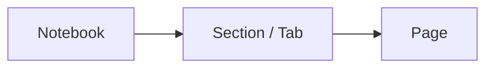

# LeNote User Guide (`v1.0.3`)

Welcome to **LeNote**, an editorial digital notebook focused on low-latency handwriting for Android tablets and phones. This guide explains the application's tools and features.

---

## Contents

1. [Getting Started](#1-getting-started)
2. [Creating Notebooks, Sections, and Pages](#2-creating-notebooks-sections-and-pages)
3. [Using the Pen and Drawing Tools](#3-using-the-pen-and-drawing-tools)
4. [Handwriting Recognition and Refinement](#4-handwriting-recognition-and-refinement)
5. [Importing and Annotating PDFs](#5-importing-and-annotating-pdfs)
6. [Exporting Documents (PDF and PNG)](#6-exporting-documents-pdf-and-png)
7. [Backing Up and Restoring `.lenote` Files](#7-backing-up-and-restoring-lenote-files)

---

## 1. Getting Started

When you open **LeNote** for the first time, you will see the **Editorial Library** (Home screen) with a ready-to-use default structure (`My Notebook` → `Quick Notes` → `Page 1`).

### Library Overview

- **Continue Writing**: A top carousel with immediate access to the last pages you edited.
- **Filter tabs**:
  - **Library**: Shows all notebooks in a responsive grid with 1, 2, or 3 columns.
  - **Favorites**: Collects all starred pages for quick access.
  - **Trash**: Temporarily keeps deleted notebooks and pages so they can be restored or permanently removed.
- **Quick settings header**:
  - **Global Search**: Search page titles or handwritten words inside notes.
  - **Language (`PT | EN | ES`)**: Choose the automatic Android language, Portuguese, English, or Spanish.
  - **Visual Theme**: Choose Light (*Warm Paper*), Dark (*Nocturnal Slate*), or System Default.
  - **Grid Density**: Display notebooks in 1, 2, or 3 columns.

---

## 2. Creating Notebooks, Sections, and Pages

LeNote organizes notes in a three-level hierarchy: **Notebooks → Sections → Pages**.

### Creating and Managing Notebooks

1. From the home screen (**Library**), tap **`+ New Notebook`** or the dashed `+` card.
2. Enter a notebook title and choose one of the editorial cover colors.
3. On any notebook card, tap the **`⋮`** menu to rename the notebook, change its cover color, export the entire notebook as PDF, export a `.lenote` backup, or move it to the Trash.

### Creating Sections and Pages (Side Index)

Inside the writing screen (Canvas), tap the **Index / Side Drawer** icon in the upper-left corner:

1. **Switch or Create a Notebook**: Use the selector at the top of the sidebar to switch notebooks or create a new one.
2. **Sections (Tabs)**: Below the active notebook, sections appear as horizontal tabs. Tap **`+`** to create a section, such as *Classes*, *Exercises*, or *Meetings*, or press/tap a section to rename and recolor it.
3. **Pages**: Tap **`+ New Page`** to add a page; switch between **List** and **Thumbnail Grid** views; and use a page's options menu to **Rename**, **Favorite (☆)**, **Duplicate**, **Move up/down**, or **Delete** it.

### Choosing Templates and Paper Colors

In the editor header or page menu, tap the **Template** button to customize the current page:

- **4 paper colors**: *Classic White* (`#FFFFFF`), *Legal Yellow* (`#FEF9C3`), *Soft Sepia* (`#F5EBE1`), and *OLED Graphite* (`#121212`).
- **9 vector templates**: **Blank**, **Ruled**, **Grid**, **Dots**, **Mathematics** (Cartesian plane), **Cornell Method**, **Weekly Planner**, **Engineering** (isometric), and **Music** (staves).

---

## 3. Using the Pen and Drawing Tools

The floating **Pill Toolbar** can be placed at the **Top**, **Bottom**, **Left**, or **Right** of the screen.

### Pressure-sensitive Pen

- Uses the native `androidx.ink` engine (`StockBrushes.pressurePen()`), changing stroke width according to stylus pressure.
- **7 editorial colors**: *Obsidian Black* (`#141413`), *Chalk White* (`#FFFFFF`), *Atelier Navy* (`#1B365D`), *Crimson* (`#B84A39`), *Botanical Green* (`#2E5A44`), *Plum* (`#6B3FA0`), and *Golden Ochre* (`#C87D20`).
- **4 widths**: *Thin*, *Medium*, *Thick*, and *Extra*.
- **Smoothing (`OFF`, `LOW`, `MEDIUM`)** reduces digitizer micro-jitter without delaying the pen tip.

### Automatic Shapes (*Draw & Hold*)

Draw a line, rectangle, circle/ellipse, or triangle freehand, then keep the pen still for approximately **400 ms**. LeNote converts the sketch into a clean geometric shape.

### Highlighter and Partial Vector Eraser

The semitransparent highlighter (`StockBrushes.highlighter()`) emphasizes content without hiding dark ink. The analytical eraser calculates exact intersections with vector segments, erasing only the touched portion without rasterizing the stroke. Hold the physical side button on your stylus to activate it temporarily.

### Gestures and Palm Rejection

- **Stylus**: Writes, erases, or selects with automatic palm rejection.
- **1 finger**: Scrolls the page. Enable **Touch Inking** to draw with a finger.
- **2 fingers (pinch)**: Zoom from `25%` to `500%` and pan the canvas.
- **2-finger tap**: Undo. **3-finger tap**: Redo.

### Text Boxes and Images

- **Text (`T`)** inserts editable, resizable, movable text blocks.
- **Image** imports photos or diagrams from the device gallery, allowing them to be moved, resized, and rotated.

---

## 4. Handwriting Recognition and Refinement

LeNote combines vector geometry algorithms with **Google ML Kit Digital Ink Recognition**.

### Lasso Selection

1. Select **Lasso** from the toolbar.
2. Circle the strokes you want on the page.
3. Use the contextual action bar to **Move**, **Recolor**, **Duplicate**, or **Delete** the selection; **Snap to Ruling**; **Improve Handwriting (Geometry)** with spline smoothing, baseline regularization, and calligraphic slant; or **Beautify with Font**, which replaces recognized handwriting with a handwritten-font text block.

### Handwriting Search (OCR + FTS5)

As you write, LeNote indexes recognized text and word coordinates in a full-text search table using **SQLite FTS5**. Global Search and the Sidebar can find page titles and handwritten words, highlighting matches on the page.

> **Language model note:** The first time recognition is used, ML Kit checks for the system language model (for example, `pt-BR` or `en-US`, approximately 20 MB). If needed, it downloads the official Google model once; recognition then runs locally on the device.

---

## 5. Importing and Annotating PDFs

1. From the **Library** or **Sidebar**, tap **Import PDF**.
2. Select a `.pdf` file in the Android document picker.
3. LeNote copies it into secure internal storage and creates a new notebook with one numbered page for each PDF page.
4. Open any page to highlight content, write in the margins, or add text boxes and images.

---

## 6. Exporting Documents (PDF and PNG)

LeNote exports notes without toolbars or interface controls, preserving quality regardless of the current zoom level.

### Exporting the Current Page as PNG

1. Tap **Export / Share** in the editor header and choose **Export PNG**.
2. A high-resolution `1600 × 2133 px` image containing the page, ruling/PDF, images, text, and strokes is saved to `Pictures/LeNote/LeNote_<Title>_<Date>.png`.
3. A banner appears with options to open or share the file.

### Exporting a Page, Section, or Notebook as PDF

1. Choose **Export Page as PDF** or **Export Notebook as PDF**. The notebook option is also available from the Library notebook's `⋮` menu.
2. LeNote renders each page with Android's native `PdfDocument` engine and saves it to `Downloads/LeNote/LeNote_<Title>_<Date>.pdf`.
3. For notebooks created from imported PDFs, the export includes the original pages with handwritten annotations overlaid in high definition.

---

## 7. Backing Up and Restoring `.lenote` Files

Use the native **`.lenote`** format to move notebooks between devices or keep complete backups, including vector `.ink` strokes, templates, text boxes, images, and attached PDFs.

### Exporting a `.lenote` Backup

1. From the **Library**, tap the `⋮` menu on the desired notebook or the **Backup** button in the header.
2. Choose **Export `.lenote` Package**.
3. Choose where to save or share the generated file.

### Restoring or Importing a `.lenote` File

1. From the **Library**, tap **Import `.lenote`** in the top header.
2. Select the saved `.lenote` file from your device or personal cloud storage.
3. The complete notebook is restored with its sections, pages, images, background PDFs, and editable strokes intact. New internal `UUID`s are assigned automatically to prevent conflicts with existing notebooks.
